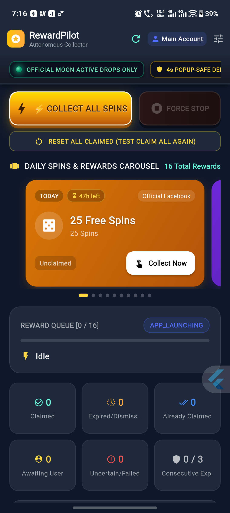

# ⚡ Coin Master Auto-Pilot (Android)

> **Autonomous, Standalone Free Spin & Coin Collector for Coin Master**  
> Built with **Flutter**, **Dart**, and native **Android Accessibility Services**.  
> **100% Standalone**: Runs directly on your Android phone with zero PC or laptop server required.

---

<p align="center">
  
</p>

<p align="center">
  <a href="https://flutter.dev"></a>
  <a href="https://dart.dev"></a>
  <a href="https://developer.android.com"></a>
  <a href="https://github.com/vivek3658/coin-master-free-spin-collect-automation/releases"></a>
</p>

---

## 🌟 What Is Coin Master Auto-Pilot?

Collecting daily free spins for Coin Master manually is tedious—it usually requires navigating ad-filled blog websites (like Levvvel) and clicking 25+ reward links one by one.

**Coin Master Auto-Pilot** completely automates this process directly on your Android device:
1. **1-Tap Autonomous Collection**: Launches each official reward drop sequentially, detects the in-game reward popup using native Android Accessibility, and clicks **"Collect"** with a safe 4-second delay.
2. **100% Official Drops Only**: Connects directly to official Moon Active sources (verified `@CoinMasterGame` Twitter syndication & algorithmic daily campaign codes). **Zero third-party scraper websites used.**
3. **Offer-Ended & 48h Expiration Filter**: Moon Active reward links expire after ~48 hours. The app automatically filters out drops older than 48 hours and automatically dismisses any "This offer is ended" popups without freezing.
4. **Auto-Scan on Open**: Refreshes and loads today's freshest spin drops whenever you open or resume the app.
5. **Skeuomorphic Retro Arcade UI**: Golden 3D Collect button, illuminated convex green/amber status LEDs, retro segment progress bar, real-time executing ticker, and emergency Ruby Red Force-Stop control.

---

## 📱 Screenshots

<p align="center">
  
</p>

---

## ⚙️ How It Works (Engineering Details)

- **Official URL Scheme Routing**: Uses `coinmaster://promotions?c=...` deep-linking to launch directly into Coin Master's native GameActivity, bypassing browser tabs and avoiding Amazon S3 403 errors.
- **Screen Recognition State Machine**: Real-time accessibility node inspection classifies in-game screens into:
  - `claimButtonAvailable` → Activates the "Collect" button.
  - `rewardExpired` ("This offer has ended") → Clicks "OK" to dismiss dialog and advances to the next drop.
  - `rewardAlreadyClaimed` → Clicks "OK" to dismiss and advances.
  - `unknownScreen` (In-game events, wheels, slot popups) → Bounded 4-second delay allows you to clear in-game banners without the queue locking or pausing.
- **Strict Chronological Sorting**: Prioritizes `Today` drops first so fresh, active "Collect" rewards are redeemed before older links.
- **Manual Retesting Mode**: Includes an instant `RESET ALL CLAIMED` button and individual `Unmark` buttons so you can re-test the entire collection sequence at any time.

---

## 🔒 Important: Keeping the Accessibility Service Persistent

On many Android devices—especially **Vivo (Funtouch OS / OriginOS)**, **Xiaomi (HyperOS / MIUI)**, and **Samsung (One UI)**—the operating system aggressively kills background accessibility services to save battery.

Follow these 3 quick steps during first-time setup so Android **never automatically turns off the service**:

### 1. Enable Accessibility Service
1. Open **Coin Master Auto-Pilot**.
2. Tap the top bar pill (**ENABLE SERVICE** or **PERSISTENT**).
3. Select **Coin Master Auto-Pilot** in Accessibility Settings and toggle it **ON**.
> *Note for Android 13/14/15/16*: If your phone shows *"Restricted setting"*, go to **Phone Settings → Apps → Coin Master Auto-Pilot → Tap 3 dots (top right) → "Allow restricted settings"**, then turn on Accessibility.

### 2. Disable Battery Optimization (Doze Mode)
1. In the app's Accessibility Guide, tap **"Keep Service Active (Disable Battery Optimization)"**.
2. When the system prompt appears, choose **"Allow" / "Don't optimize" / "Unrestricted"**.
*(Or manually: Phone Settings → Battery → Battery Optimization → Coin Master Auto-Pilot → Set to "Unrestricted").*

### 3. Lock App in Recent Apps (Vivo / Xiaomi / Samsung)
1. Open your phone's App Switcher / Recent Apps screen.
2. Long-press or swipe down on the **Coin Master Auto-Pilot** card.
3. Tap the **Lock icon (🔒)**. This tells Android's memory killer never to clear the app from RAM.
4. *(Xiaomi / Vivo only)*: In App Info, toggle **Auto-start** to **ON**.

---

## 📥 Download Prebuilt APK

Download the latest signed APK directly from the [Releases](https://github.com/vivek3658/coin-master-free-spin-collect-automation/releases) page:

- **`CoinMaster-AutoPilot-Universal.apk`**: Compatible with **all** Android devices (ARM64, ARMv7, x86_64).
- **`CoinMaster-AutoPilot-arm64.apk`**: Optimized for modern 64-bit phones (Snapdragon, MediaTek, Exynos, Tensor).

---

## 🛠️ Building from Source

### Prerequisites
- [Flutter SDK](https://docs.flutter.dev/get-started/install) (v3.19 or higher)
- Android SDK (API 21 to 36)
- Java 11 or 17

### Build Commands
```bash
# Clone the repository
git clone https://github.com/vivek3658/coin-master-free-spin-collect-automation.git
cd coin-master-free-spin-collect-automation

# Fetch Flutter dependencies
flutter pub get

# Run unit tests
flutter test

# Build release APK
flutter build apk --release
```

---

## 📄 License
This project is open-source under the MIT License.
